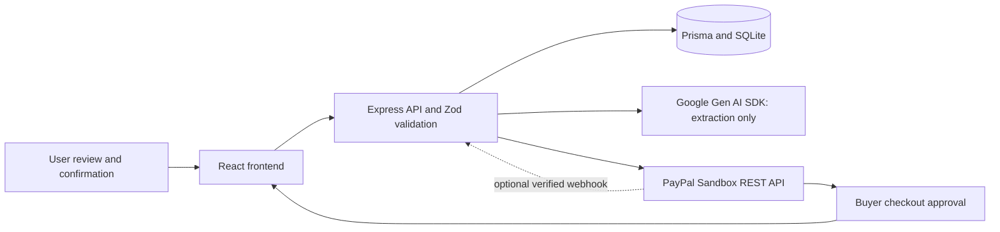

# PayPilot AI

PayPilot AI helps freelancers turn a written request into a reviewed invoice and collect a PayPal Sandbox payment. It uses React, TypeScript, Vite, Tailwind CSS and Lucide for the interface; Express, Prisma and SQLite for the API and storage; the official Google Gen AI SDK for extraction; and PayPal REST Orders v2 for checkout.

**Status:** Stages 1–5 are implemented; Stage 6 prepares deployment and submission materials. No Render deployment, live Gemini request, real PayPal Sandbox transaction, or live webhook delivery has been verified. The deployment target is a **private single-user demo**, with access through SSH. There is no public login or public demo URL.

## Implemented scope and architecture

| Stage | Implementation |
| --- | --- |
| 1 | Landing, dashboard, AI invoice editor, invoice list/details, payment return/cancellation pages; reusable responsive UI. |
| 2 | Persistent invoices, draft editing with version checks, status management, payments, dashboard totals separated by currency, server validation. |
| 3 | Structured Gemini extraction, clarification, editable review, explicit confirmation, bounded calls and safe errors. |
| 4 | Sandbox OAuth, order creation, approval redirect, capture, verification, reconciliation, retries and signature-verified completed-capture webhooks. |
| 5 | Focused security review and 40 automated tests. Fixed stale checkout state after lease acquisition and malformed provider responses being classified as client errors. |
| 6 | Production build, private Render Blueprint, environment/setup/deployment guide, submission checklist, screenshot placeholders and demo script. |



The server serves the built frontend and `/api` from one process. Development uses Vite's API proxy. Hash routes need no server fallback. User → Invoice → Payment relationships retain line items and notes; Checkout stores unique order associations, persisted request keys and a database lease. Money uses integer minor units; USD, EUR, GBP and INR currently use two decimals. Account support for a currency still needs provider testing.

```text
client/src/              Existing pages, components, invoice adapter and API client
server/src/              API, configuration, startup, migrations and tests
server/src/services/     Modular Gemini and PayPal services
shared/                 Safe shared schemas and types; no credentials
prisma/                 Schema and additive migration history
render.yaml             Private Render service with persistent SQLite disk
.env.example            Placeholder environment configuration
AGENTS.md               Project rules and stage boundaries
```

No public authentication, invoice emailing, live-money payments, refunds/reversal reconciliation or multi-user deployment is implemented. Legacy manual bookkeeping is available for invoices without a PayPal checkout and is distinct from verified PayPal payments.

## Run locally

Use Node.js 24.14.0 (the Render pin); the package requires Node 22.12 or newer. Run from the repository root:

```powershell
npm ci
if (-not (Test-Path .env)) { Copy-Item .env.example .env }
npm run db:generate
npm run db:migrate
npm run dev
```

On macOS/Linux, create `.env` with `test -f .env || cp .env.example .env` instead. Open `http://127.0.0.1:5173`; the API binds to `127.0.0.1:3001`. Existing migrations apply without resetting records. Never seed the active workspace with test fixtures.

For the built app, set `CLIENT_ORIGIN=http://127.0.0.1:3001` in `.env`, then run:

```text
npm run build
npm start
```

Open `http://127.0.0.1:3001`. Restore origin port 5173 before returning to Vite development. `npm run preview` previews frontend assets only; use `npm start` for the complete built application.

| Command | Purpose |
| --- | --- |
| `npm run dev` | Frontend and backend together |
| `npm run db:generate` | Generate Prisma client |
| `npm run db:migrate` | Create SQLite file if absent and apply committed migrations without reset |
| `npm test` | Unit, HTTP and temporary SQLite tests; provider responses mocked |
| `npm run lint` / `npm run typecheck` | Source lint / frontend and backend type checks |
| `npm run build` | Production backend and frontend output in ignored `dist/` |
| `npm run check` | Lint, types, all tests and both builds |
| `npm start` | Serve built app and API |

## Environment variables

All values belong in the ignored root `.env` locally or Render's server environment. Never add secrets to `VITE_*`, GitHub, screenshots, logs or the video. `.env.example` contains placeholders. No frontend environment variables are required.

| Variable | Required / default | Local / Render configuration |
| --- | --- | --- |
| `DATABASE_URL` | Required | Local `file:./dev.db` (relative to `prisma/`); Render `file:/var/data/paypilot.db`. |
| `PORT` | Default `3001` | Blueprint pins `3001` for the SSH tunnel. |
| `HOST` | Default `127.0.0.1` | Local loopback; `0.0.0.0` only for the private Render service's port detection. |
| `CLIENT_ORIGIN` | Default `http://127.0.0.1:5173` | Built app and Render tunnel: `http://127.0.0.1:3001`. Only localhost/127.0.0.1 ports 5173/3001 are supported. |
| `LOCAL_USER_EMAIL` | Default `owner@example.test` | Stable local owner identity, **not authentication**. Changing it selects/creates another owner; it does not transfer invoices. |
| `GEMINI_API_KEY` | Required for AI only | Server secret from your Google AI project; blank disables AI. |
| `GEMINI_MODEL` | Required for AI only | A model ID available to your project supporting structured JSON; the example value is illustrative, not verified account access. |
| `INVOICE_TIMEZONE` | Default `Asia/Kolkata` | Valid IANA timezone used to resolve relative due dates. |
| `PAYPAL_ENV` | Only `sandbox`; default | Production mode is rejected. |
| `PAYPAL_CLIENT_ID` | Required for PayPal only | Sandbox REST application's client ID. |
| `PAYPAL_CLIENT_SECRET` | Required for PayPal only | Same app's server secret; never sent to the browser. |
| `PAYPAL_MERCHANT_ID` | Required for PayPal only | Same Sandbox business account's merchant ID, not its REST client ID. |
| `PAYPAL_WEBHOOK_ID` | Optional | Subscription ID for signature verification; no webhook processing without it. |
| `NODE_VERSION` | Render runtime setting | Blueprint pins `24.14.0`; not an application setting. |
| `NODE_ENV` | Render `production` | Platform/runtime setting; development scripts work without it. |

Missing AI credentials preserve manual invoice entry. Missing PayPal credentials disable checkout and return a clear server configuration error. Invalid configuration reports variable names without their values. Server-origin validation remains restricted even when `HOST=0.0.0.0`.

### Gemini configuration and behavior

Create an API key in [Google AI Studio](https://aistudio.google.com/apikey), select a structured-output model available to that project, and set `GEMINI_API_KEY` and `GEMINI_MODEL` on the server. Restart locally or manually redeploy on Render. Check project access/quota yourself; no live model test is included in the automated suite.

The modular `server/src/services/gemini-invoice.ts` uses `@google/genai`, structured JSON output and Zod validation. It extracts customer name/email, decimal amount, currency, description and due date. Missing information returns null plus clarification questions; customer names/emails not found verbatim in the request are discarded. A bare `$` is ambiguous, so use `USD`. Relative dates are computed using the server's reference date and timezone.

Generation runs only when requested, with 2,000-character prompts, bounded output, timeouts, no automatic retry, one request in flight and six attempts per minute per process. Extraction has no database write path. The user edits fields, reviews them and separately confirms creation; the API requires `confirmed: true`. Interpretation remains fallible, so review every field.

### PayPal Sandbox configuration and flow

In the [PayPal Developer Dashboard](https://developer.paypal.com/dashboard/), create/select a **Sandbox** REST app under a Sandbox business account. Set its client ID, secret and business merchant ID on the server. Use a separate Sandbox personal buyer account to approve checkout. Restart/redeploy after configuration. These instructions require your own provider accounts; do not submit their passwords or keys.

1. Create and confirm a valid invoice, then click **Pay / Retry in Sandbox** and confirm checkout.
2. The backend checks ownership, loads the saved amount/currency, issues and locks the draft, stores idempotency keys and creates an Orders v2 order using server-side OAuth. The fixed API base is `https://api-m.sandbox.paypal.com`.
3. Follow the returned allowlisted Sandbox approval link and approve as the buyer. The API base itself is not a checkout webpage.
4. On return, **Check payment** reads server state. Click **Verify and capture approved payment** to request capture. A return URL alone never marks PAID.
5. The backend verifies the stored order association, invoice, merchant, amount and currency, then retrieves and validates the completed final capture. A database transaction records one unique capture and marks the invoice PAID.
6. Refresh/replay checks and confirm one completed payment remains. On an uncertain response, check the existing order; do not pay separately. Retries GET first, reuse persisted keys, and replace only verified VOIDED orders with no captures. Expired uncertain attempts require manual reconciliation.

The database lease serializes payment operations, and unique order/capture/invoice-payment constraints prevent duplicate records in the tested scenarios. Invoice editing and manual status updates are blocked once a checkout exists. Pending, denied or mismatched captures do not settle an invoice.

Optional webhook: subscribe to `PAYMENT.CAPTURE.COMPLETED` on the same REST app and set `PAYPAL_WEBHOOK_ID`. `/api/paypal/webhook` verifies original event/signature headers via PayPal and then re-fetches the authoritative associated order. Other verified event types do not change state. The private Blueprint has no public webhook URL. Live delivery requires a separately configured HTTPS relay exposing **only** that route and preserving body/transmission headers with an allowed loopback Host; no relay is provisioned here. Return-page reconciliation works without webhooks.

API endpoints: `GET /api/health`, `GET /api/ai/status`, `POST /api/ai/invoice-draft`, invoice CRUD/status and dashboard routes; `GET /api/paypal/status`, `POST /api/invoices/:id/paypal/order` with only `{ "confirmed": true }`, `POST /api/invoices/:id/paypal/check` with `{ "orderId": "...", "capture": false }` (explicit true permits capture), and `POST /api/paypal/webhook`.

References: [Orders v2](https://developer.paypal.com/docs/api/orders/v2/), [idempotency](https://developer.paypal.com/api/rest/reference/idempotency/), [webhook verification](https://developer.paypal.com/api/rest/webhooks/rest/).

## GitHub repository preparation

The existing remote is [jsbinaryrepo/Paypilot-AI](https://github.com/jsbinaryrepo/Paypilot-AI). Do not initialize another repository or overwrite its history. At inspection, implementation files were largely untracked; a successful local build does not mean they are on GitHub.

Before publishing, review and stage the implementation explicitly:

```text
git status --short
git remote -v
git check-ignore .env prisma/dev.db
git add .gitignore .env.example AGENTS.md README.md render.yaml package.json package-lock.json eslint.config.js tsconfig.server.json vite.config.ts client server shared prisma
git diff --cached --stat
git diff --cached
```

Review the staged diff for credentials, personal data, unrelated work and generated artifacts before committing. Keep `.env`, SQLite databases, `node_modules/` and `dist/` ignored. Then commit the reviewed files and push your chosen branch to the existing origin through your normal GitHub workflow; no commit or push is performed by this preparation stage. Give Render access to only the required repository. Add a concise repository description, topic tags and the eventual demo video link through GitHub settings. Do not invent a license: choose one only if you have permission to license all included work. Use a reviewed submission commit SHA so reviewers can reproduce the build.

## Render deployment preparation

`render.yaml` defines one **paid private Node service**, one instance and a 1 GB persistent disk at `/var/data`. There is no public `onrender.com` URL for this service. Private access preserves the current single-user architecture; public authentication is outside this stage. Confirm plan/storage costs in Render before creating resources. See [private services](https://render.com/docs/private-services), [Blueprint specification](https://render.com/docs/blueprint-spec) and [persistent disks](https://render.com/docs/disks).

1. Push the reviewed source, lockfile, Prisma migrations and Blueprint to your GitHub branch.
2. In Render, create a Blueprint from that repository/branch. Review the private service, paid plan and disk. The repository root must contain `package.json` and `render.yaml`; do not set the root to `client/` or `server/`.
3. Set the prompted `sync: false` Gemini/PayPal values in Render's environment UI. If intentionally demonstrating missing credentials, leave those integrations disabled and say so. Add optional `PAYPAL_WEBHOOK_ID` only when a relay/subscription exists. Do not upload `.env`.
4. Build runs `npm ci --include=dev && npm run db:generate && npm run build`. Tooling dependencies are needed for TypeScript/Vite/Prisma; do not prune them before this command. No provider calls or database writes are required during build.
5. Startup runs `node dist/server/src/migrate.js && npm start`. Migration runs at startup because the disk is unavailable during build and pre-deploy. It opens a missing SQLite file without truncating existing data, applies migrations, then starts the server. A failed migration prevents startup.
6. Check logs and Render's private-service TCP readiness. No HTTP health-check field is configured for the private service; verify `/api/health` yourself through SSH/tunnel. The disk supports one instance; keep single-instance deployment and expect downtime during redeployment. Back up SQLite consistently before migrations using a SQLite-aware backup procedure, not a live database file copy.
7. Configure your own SSH public key in Render and copy the service's SSH destination from **Connect → SSH**. Follow [Render SSH setup](https://render.com/docs/ssh); never share your private key. Verify Render's documented host fingerprint.
8. Stop your local API if it occupies port 3001, then substitute the actual SSH destination below and keep the tunnel open:

```text
ssh -N -o ExitOnForwardFailure=yes -L 127.0.0.1:3001:127.0.0.1:3001 SERVICE_SSH_DESTINATION
```

Open `http://127.0.0.1:3001` and `http://127.0.0.1:3001/api/health`. Keep this exact host/port so browser origin validation and PayPal redirects match `CLIENT_ORIGIN`. SSH encrypts the remote leg; the browser uses local loopback. Render documents [private UI access using SSH forwarding](https://render.com/docs/deploy-temporal#ui-access). This project's actual Render startup, tunnel and remote provider flow remain unverified until you run them.

Auto-deploy is off; use a deliberate manual deploy after environment/source changes. New deployments start with a fresh database on the disk: local invoices are not uploaded. Preserve the disk across redeploys and verify a synthetic invoice survives restart. If you need a public judge-accessible URL, record that requirement as unresolved; changing service type or removing Host/origin checks would expose this unauthenticated workspace. Share a video or run a supervised private demo instead.

## Verification and manual demo

Stage 6 verification: `npm run check` passed lint, frontend/backend TypeScript, **40 tests with zero failures**, and both production builds on Node 24.14.0. Automated tests use mocked Gemini/PayPal transports and real temporary migrated SQLite databases. Coverage includes confirmation, malformed/hostile model output, missing customer details, invoice validation/ownership, price tampering, capture association, currency/amount/finality, duplicates, lost responses, lease concurrency, signature/replay handling and atomic rollback/recovery. Existing Lucide/Zod annotation warnings are non-fatal.

Local YAML parsing and configuration assertions passed for the private service, disk, runtime migration command, unique environment keys and secret placeholders. Render-side Blueprint validation/import remains manual. A compiled startup smoke check passed with a fresh temporary SQLite file, `NODE_ENV=production` and `HOST=0.0.0.0`: migrations, database health, built frontend, raw HTTP Host rejection and disabled PayPal status. An initial fetch-based custom-Host probe failed its assertion; the raw HTTP probe verified the intended 403 response without an application change. No provider calls were made. No browser checks were repeated.

Locally missing integration values at inspection: `GEMINI_API_KEY`, `GEMINI_MODEL`, `PAYPAL_CLIENT_ID`, `PAYPAL_CLIENT_SECRET`, `PAYPAL_MERCHANT_ID`; optional `PAYPAL_WEBHOOK_ID` is also unset. Stage 6 changed only `render.yaml`, `.env.example`, `AGENTS.md`, this README, `server/src/config.ts`, `server/src/index.ts`, and the existing configuration test in `server/src/app.test.ts`. The server change makes only the bind address configurable and retains the local default and access guards.

No real provider transaction, live Gemini interpretation, webhook delivery, Render deployment or screenshots are claimed as tested. Remaining limitations include local-only identity, no public login, manual reconciliation of expired uncertain attempts, and no refund/reversal processing. Tests do not establish production security guarantees.

Before recording, configure your own credentials, use synthetic customer data, and rehearse this sequence:

1. Open landing/dashboard, then enter: `Create an invoice for Rahul (rahul@example.test) for USD 150 for landing page design, due in 5 days.` Generate once. Confirm that no invoice exists yet; show fields/clarifications and edit a value.
2. Review, explicitly confirm, reload, and show the persisted invoice/list/dashboard. With missing credentials, use manual entry and clearly label AI as untested; do not simulate generation.
3. Start Sandbox checkout, approve with the separate buyer, return and explicitly capture. Show success only after actual server verification. Inspect one completed payment matching the saved amount/currency and a PAID invoice.
4. Replay Check payment, then separately rehearse cancellation/resume and a funding failure using supported Sandbox tools. For uncertain responses, reconcile the existing order rather than starting a separate payment. If webhook relay is configured, test valid delivery/replay and rejected signatures.
5. Record actual outcomes and any failures. Keep provider accounts, tokens, keys, real emails and terminal secret values out of the recording. If a live flow fails, disclose it and show the implemented code/tests rather than a fabricated success screen.

## Screenshot placeholders

No images are fabricated or attached. Replace these entries only with screenshots captured from the actual app; create an image folder only when real assets exist.

| Planned image | Capture / current status |
| --- | --- |
| Landing and responsive navigation | Placeholder — not captured |
| Dashboard with persisted synthetic invoices | Placeholder — not captured |
| AI extracted fields and clarification/review | Placeholder — live Gemini not verified |
| Invoice list and saved details | Placeholder — not captured |
| Sandbox approval and server-verified payment | Placeholder — real transaction not verified |
| Cancellation/resume and safe error state | Placeholder — not captured |

## Demo video script — target 2 minutes 45 seconds

Rehearse within these time slots; edit waiting time transparently if needed. Record a successful provider flow only after it actually succeeds. This is a script, not evidence of a completed demo.

| Time | Screen and narration |
| --- | --- |
| 0:00–0:20 | Landing → dashboard. “PayPilot AI helps freelancers turn a written request into a reviewed invoice and a PayPal Sandbox checkout. This is a single-user prototype.” |
| 0:20–0:55 | Enter the Rahul request and generate once. “Gemini extracts structured fields. Missing details require clarification. I can edit every value, and generation alone creates no invoice.” If credentials are unavailable, say so and show manual entry instead. |
| 0:55–1:20 | Change a field, review and explicitly confirm; reload the saved invoice. “Server validation checks the total, currency and line items. Prisma stores the confirmed draft in SQLite.” |
| 1:20–2:05 | Start checkout, approve as the Sandbox buyer, return and capture. “The server uses the stored invoice total. A return URL does not prove payment; the server verifies the associated order and completed capture.” Only show a verified result if achieved; otherwise state the actual error and that real Sandbox testing remains incomplete. |
| 2:05–2:25 | Refresh Check payment and show recorded state if verified. “Retries reconcile the existing order and use persisted request keys. Automated tests cover duplicate requests, mismatched totals and uncertain responses using mocked APIs.” |
| 2:25–2:45 | Show architecture/tests and close. “React calls Express; Gemini extracts and PayPal handles Sandbox checkout. We have automated validation and payment tests. Render deployment is prepared as a private service; its actual deployment status and any remaining live tests are disclosed in the submission.” |

## Final submission checklist

- [ ] Review and push the intended files; supply repository URL and submission commit SHA.
- [ ] Re-run `npm run check` on that commit and record the actual result.
- [ ] Configure provider credentials privately and verify live Gemini/model access.
- [ ] Complete the manual Sandbox approval/capture, cancellation/retry and duplicate checks; record actual results.
- [ ] Validate/import the Blueprint in Render, provision the paid disk/service, and verify startup, tunnel, health and persistence.
- [ ] State “private deployment” or “not deployed” accurately; leave public demo URL unset if none exists.
- [ ] Capture and redact actual screenshots; replace placeholders only with real evidence.
- [ ] Record/upload the video under 3 minutes and add its real link to the submission.
- [ ] Disclose mocked versus real tests, missing live verification, public-access limitations and refunds/reversals scope.
- [ ] Confirm the hackathon's required fields/rules and provide team attribution and any license information you actually have.
