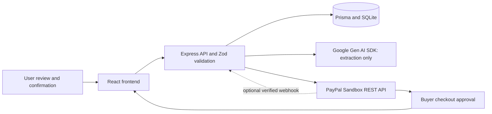

# PayPilot AI

PayPilot AI helps freelancers turn a written request into a reviewed invoice and collect a PayPal Sandbox payment. It uses React, TypeScript, Vite, Tailwind CSS and Lucide for the interface; Express, Prisma and SQLite for the API and storage; the official Google Gen AI SDK for extraction; and PayPal REST Orders v2 for checkout.

**Status:** Stages 1–6 are implemented. The free Render site is a no-sign-in, browser-only manual invoice demo. Drafts stay in each visitor's browser; Gemini, PayPal and the shared server database are unavailable to that public UI. The server `/api` remains password protected. No live Gemini request, real PayPal Sandbox transaction, or live webhook delivery has been verified.

## Implemented scope and architecture

| Stage | Implementation |
| --- | --- |
| 1 | Landing, dashboard, AI invoice editor, invoice list/details, payment return/cancellation pages; reusable responsive UI. |
| 2 | Persistent invoices, draft editing with version checks, status management, payments, dashboard totals separated by currency, server validation. |
| 3 | Structured Gemini extraction, clarification, editable review, explicit confirmation, bounded calls and safe errors. |
| 4 | Sandbox OAuth, order creation, approval redirect, capture, verification, reconciliation, retries and signature-verified completed-capture webhooks. |
| 5 | Focused security review and 40 automated tests. Fixed stale checkout state after lease acquisition and malformed provider responses being classified as client errors. |
| 6 | Production build, private Render Blueprint, environment/setup/deployment guide, submission checklist, screenshot placeholders and demo script. |



The server serves the built frontend and `/api` from one process. Development uses Vite's API proxy. Hash routes need no server fallback. User → Invoice → Payment relationships retain line items and notes; Checkout stores unique order associations, persisted request keys and a database lease. Money uses integer minor units; USD, EUR, GBP and INR currently use two decimals. Account support for a currency still needs provider testing.

```text
client/src/              Existing pages, components, invoice adapter and API client
server/src/              API, configuration, startup, migrations and tests
server/src/services/     Modular Gemini and PayPal services
shared/                 Safe shared schemas and types; no credentials
prisma/                 Schema and additive migration history
render.yaml             Free Render web service with temporary SQLite data
.env.example            Placeholder environment configuration
AGENTS.md               Project rules and stage boundaries
```

No individual user accounts, automatic invoice emailing, live-money payments, refunds/reversal reconciliation or multi-user deployment is implemented. An invoice's **Compose email** link prepares its details in the visitor's email app; the visitor must review and send it, and delivery is not tracked. The public browser demo is not a payment service. The server's Basic gate protects its shared API; it is not production account security. Legacy manual bookkeeping in the local full app is distinct from verified PayPal payments.

## Run locally

Use Node.js 24.14.0 (the Render pin); the package requires Node 22.12 or newer. Run from the repository root:

```powershell
npm ci
if (-not (Test-Path .env)) { Copy-Item .env.example .env }
npm run db:generate
npm run db:migrate
npm run dev
```

On macOS/Linux, create `.env` with `test -f .env || cp .env.example .env` instead. Open `http://127.0.0.1:5173`; the API binds to `127.0.0.1:3001`. Existing migrations apply without resetting records. Never seed the active workspace with test fixtures.

For the built app, set `CLIENT_ORIGIN=http://127.0.0.1:3001` in `.env`, then run:

```text
npm run build
npm start
```

Open `http://127.0.0.1:3001`. Restore origin port 5173 before returning to Vite development. `npm run preview` previews frontend assets only; use `npm start` for the complete built application.

| Command | Purpose |
| --- | --- |
| `npm run dev` | Frontend and backend together |
| `npm run db:generate` | Generate Prisma client |
| `npm run db:migrate` | Create SQLite file if absent and apply committed migrations without reset |
| `npm test` | Unit, HTTP and temporary SQLite tests; provider responses mocked |
| `npm run lint` / `npm run typecheck` | Source lint / frontend and backend type checks |
| `npm run build` | Production backend and frontend output in ignored `dist/` |
| `npm run check` | Lint, types, all tests and both builds |
| `npm start` | Serve built app and API |

## Environment variables

All values belong in the ignored root `.env` locally or Render's server environment. Never add secrets to `VITE_*`, GitHub, screenshots, logs or the video. `.env.example` contains placeholders. No frontend environment variables are required.

| Variable | Required / default | Local / Render configuration |
| --- | --- | --- |
| `DATABASE_URL` | Required | Local and free Render `file:./dev.db` (relative to `prisma/`); free Render storage is temporary. |
| `PORT` | Default `3001` | Render service pins `3001`. |
| `HOST` | Default `127.0.0.1` | Local loopback; free Render uses `0.0.0.0` for port detection. |
| `CLIENT_ORIGIN` | Default `http://127.0.0.1:5173` | Built local app: `http://127.0.0.1:3001`; free Render: `https://paypilot-ai-3sho.onrender.com`. |
| `DEMO_PASSWORD` | Required for public Render origin | At least 32 random characters in Render's private environment. Protects `/api`; the public browser-only UI does not use it. Do not commit or share it. |
| `VITE_PUBLIC_DEMO` | Default false | Build-time frontend switch. Set true only for the public browser-only demo; it contains no secret. |
| `LOCAL_USER_EMAIL` | Default `owner@example.test` | Stable local owner identity, **not authentication**. Changing it selects/creates another owner; it does not transfer invoices. |
| `GEMINI_API_KEY` | Required for AI only | Server secret from your Google AI project; blank disables AI. |
| `GEMINI_MODEL` | Required for AI only | A model ID available to your project supporting structured JSON; the example value is illustrative, not verified account access. |
| `INVOICE_TIMEZONE` | Default `Asia/Kolkata` | Valid IANA timezone used to resolve relative due dates. |
| `PAYPAL_ENV` | Only `sandbox`; default | Production mode is rejected. |
| `PAYPAL_CLIENT_ID` | Required for PayPal only | Sandbox REST application's client ID. |
| `PAYPAL_CLIENT_SECRET` | Required for PayPal only | Same app's server secret; never sent to the browser. |
| `PAYPAL_MERCHANT_ID` | Required for PayPal only | Same Sandbox business account's merchant ID, not its REST client ID. |
| `PAYPAL_WEBHOOK_ID` | Optional | Subscription ID for signature verification; no webhook processing without it. |
| `NODE_VERSION` | Render runtime setting | Blueprint pins `24.14.0`; not an application setting. |
| `NODE_ENV` | Render `production` | Platform/runtime setting; development scripts work without it. |

Missing AI credentials preserve manual invoice entry. Missing PayPal credentials disable checkout and return a clear server configuration error. Invalid configuration reports variable names without their values. Server-origin validation remains restricted even when `HOST=0.0.0.0`.

### Gemini configuration and behavior

Create an API key in [Google AI Studio](https://aistudio.google.com/apikey), select a structured-output model available to that project, and set `GEMINI_API_KEY` and `GEMINI_MODEL` on the server. Restart locally or manually redeploy on Render. Check project access/quota yourself; no live model test is included in the automated suite.

The modular `server/src/services/gemini-invoice.ts` uses `@google/genai`, structured JSON output and Zod validation. It extracts customer name/email, decimal amount, currency, description and due date. Missing information returns null plus clarification questions; customer names/emails not found verbatim in the request are discarded. A bare `$` is ambiguous, so use `USD`. Relative dates are computed using the server's reference date and timezone.

Generation runs only when requested, with 2,000-character prompts, bounded output, timeouts, no automatic retry, one request in flight and six attempts per minute per process. Extraction has no database write path. The user edits fields, reviews them and separately confirms creation; the API requires `confirmed: true`. Interpretation remains fallible, so review every field.

### PayPal Sandbox configuration and flow

In the [PayPal Developer Dashboard](https://developer.paypal.com/dashboard/), create/select a **Sandbox** REST app under a Sandbox business account. Set its client ID, secret and business merchant ID on the server. Use a separate Sandbox personal buyer account to approve checkout. Restart/redeploy after configuration. These instructions require your own provider accounts; do not submit their passwords or keys.

1. Create and confirm a valid invoice, then click **Pay / Retry in Sandbox** and confirm checkout.
2. The backend checks ownership, loads the saved amount/currency, issues and locks the draft, stores idempotency keys and creates an Orders v2 order using server-side OAuth. The fixed API base is `https://api-m.sandbox.paypal.com`.
3. Follow the returned allowlisted Sandbox approval link and approve as the buyer. The API base itself is not a checkout webpage.
4. On return, **Check payment** reads server state. Click **Verify and capture approved payment** to request capture. A return URL alone never marks PAID.
5. The backend verifies the stored order association, invoice, merchant, amount and currency, then retrieves and validates the completed final capture. A database transaction records one unique capture and marks the invoice PAID.
6. Refresh/replay checks and confirm one completed payment remains. On an uncertain response, check the existing order; do not pay separately. Retries GET first, reuse persisted keys, and replace only verified VOIDED orders with no captures. Expired uncertain attempts require manual reconciliation.

The database lease serializes payment operations, and unique order/capture/invoice-payment constraints prevent duplicate records in the tested scenarios. Invoice editing and manual status updates are blocked once a checkout exists. Pending, denied or mismatched captures do not settle an invoice.

Optional webhook: subscribe to `PAYMENT.CAPTURE.COMPLETED` on the same REST app and set `PAYPAL_WEBHOOK_ID`. `/api/paypal/webhook` verifies original event/signature headers via PayPal and then re-fetches the associated order. The public Render demo protects `/api`, so live webhook delivery is unavailable there. The local full app can use return-page reconciliation without webhooks.

API endpoints: `GET /api/health`, `GET /api/ai/status`, `POST /api/ai/invoice-draft`, invoice CRUD/status and dashboard routes; `GET /api/paypal/status`, `POST /api/invoices/:id/paypal/order` with only `{ "confirmed": true }`, `POST /api/invoices/:id/paypal/check` with `{ "orderId": "...", "capture": false }` (explicit true permits capture), and `POST /api/paypal/webhook`.

References: [Orders v2](https://developer.paypal.com/docs/api/orders/v2/), [idempotency](https://developer.paypal.com/api/rest/reference/idempotency/), [webhook verification](https://developer.paypal.com/api/rest/webhooks/rest/).

## GitHub repository preparation

The existing remote is [jsbinaryrepo/Paypilot-AI](https://github.com/jsbinaryrepo/Paypilot-AI). Do not initialize another repository or overwrite its history. At inspection, implementation files were largely untracked; a successful local build does not mean they are on GitHub.

Before publishing, review and stage the implementation explicitly:

```text
git status --short
git remote -v
git check-ignore .env prisma/dev.db
git add .gitignore .env.example AGENTS.md README.md render.yaml package.json package-lock.json eslint.config.js tsconfig.server.json vite.config.ts client server shared prisma
git diff --cached --stat
git diff --cached
```

Review the staged diff for credentials, personal data, unrelated work and generated artifacts before committing. Keep `.env`, SQLite databases, `node_modules/` and `dist/` ignored. Use a reviewed submission commit SHA so reviewers can reproduce the build. Add a demo video link only after it exists; do not invent a license.

## Free Render deployment

The existing Render **Free Web Service** is `Paypilot-AI` at [paypilot-ai-3sho.onrender.com](https://paypilot-ai-3sho.onrender.com). `render.yaml` records the free configuration. The public frontend stores only manual drafts in each visitor's browser storage. It has no sign-in prompt and makes no API, Gemini or PayPal calls. Clearing browser storage removes those drafts; they do not sync across devices. The server's shared SQLite is ephemeral and inaccessible to the public UI. Use synthetic demo data only.

Configure the existing service in Render from the repository root and `main` branch:

| Setting | Value |
| --- | --- |
| Build command | `npm ci --include=dev && npm run db:generate && npm run build` |
| Start command | `node dist/server/src/migrate.js && npm start` |
| `NODE_VERSION` / `NODE_ENV` | `24.14.0` / `production` |
| `DATABASE_URL` | `file:./dev.db` |
| `HOST` / `PORT` | `0.0.0.0` / `3001` |
| `CLIENT_ORIGIN` | `https://paypilot-ai-3sho.onrender.com` |
| `DEMO_PASSWORD` | A private random string of at least 32 characters |
| `VITE_PUBLIC_DEMO` | `true` |
| `LOCAL_USER_EMAIL` / `INVOICE_TIMEZONE` | `owner@example.test` / `Asia/Kolkata` |
| `PAYPAL_ENV` | `sandbox` |

Set `DEMO_PASSWORD` in Render's private environment, never in GitHub or the client. It protects `/api`, while the built frontend is public and uses browser storage. Render's health probe may receive 401 on `/api/health`; use startup logs and an authenticated health request for backend checks. The local full app still uses SQLite and can use Gemini/PayPal when configured. Do not add payment credentials to the free public demo merely to show its UI.

After pushing a reviewed commit, set `VITE_PUBLIC_DEMO=true` in the existing service's environment and rebuild/deploy. Verify the public landing and browser-only create/list/edit flow without a sign-in prompt, and verify `/api/health` still challenges unauthenticated requests. A real PayPal Sandbox test belongs in the protected local full app and must be reported as real only after provider approval, verified capture and database state have been observed.

## Verification and manual demo

No-sign-in demo verification: `VITE_PUBLIC_DEMO=true npm run check:client` passed lint, TypeScript and frontend build. The backend suite passed **41 tests with zero failures** after one Node import error from the new Vite flag was fixed. A local browser check created a synthetic manual draft, reviewed and confirmed it, reloaded it, reopened it for editing, and found it in the invoice list. The browser-only payment page reported that no PayPal order or payment can be created. The earlier Stage 6 build and mocked-provider test results remain separate from live provider testing.

The earlier private Blueprint check and startup smoke result apply only to the prior paid configuration. The free service requires separate deployment verification. The automated suite now also checks public-origin password configuration and Basic access. No provider calls were made by tests.

Render already has a masked `GEMINI_API_KEY` entry. Its value and live access were not inspected; `GEMINI_MODEL` and PayPal settings were not visible among the service variables. AI needs both key and model, and PayPal needs its own Sandbox settings. Do not copy or expose local secrets to complete the demo automatically.

No real provider transaction, live Gemini interpretation, webhook delivery or screenshots are claimed as tested. Remaining limitations include shared demo identity, ephemeral SQLite, manual reconciliation of expired uncertain attempts, and no refund/reversal processing. Tests do not establish production security guarantees.

Before recording, configure your own credentials, use synthetic customer data, and rehearse this sequence:

1. Open landing/dashboard, then enter: `Create an invoice for Rahul (rahul@example.test) for USD 150 for landing page design, due in 5 days.` Generate once. Confirm that no invoice exists yet; show fields/clarifications and edit a value.
2. Review, explicitly confirm, reload, and show the persisted invoice/list/dashboard. With missing credentials, use manual entry and clearly label AI as untested; do not simulate generation.
3. Start Sandbox checkout, approve with the separate buyer, return and explicitly capture. Show success only after actual server verification. Inspect one completed payment matching the saved amount/currency and a PAID invoice.
4. Replay Check payment, then separately rehearse cancellation/resume and a funding failure using supported Sandbox tools. For uncertain responses, reconcile the existing order rather than starting a separate payment. If webhook relay is configured, test valid delivery/replay and rejected signatures.
5. Record actual outcomes and any failures. Keep provider accounts, tokens, keys, real emails and terminal secret values out of the recording. If a live flow fails, disclose it and show the implemented code/tests rather than a fabricated success screen.

## Screenshot placeholders

No images are fabricated or attached. Replace these entries only with screenshots captured from the actual app; create an image folder only when real assets exist.

| Planned image | Capture / current status |
| --- | --- |
| Landing and responsive navigation | Placeholder — not captured |
| Dashboard with persisted synthetic invoices | Placeholder — not captured |
| AI extracted fields and clarification/review | Placeholder — live Gemini not verified |
| Invoice list and saved details | Placeholder — not captured |
| Sandbox approval and server-verified payment | Placeholder — real transaction not verified |
| Cancellation/resume and safe error state | Placeholder — not captured |

## Demo video script — target 2 minutes 45 seconds

Rehearse within these time slots; edit waiting time transparently if needed. Record a successful provider flow only after it actually succeeds. This is a script, not evidence of a completed demo.

| Time | Screen and narration |
| --- | --- |
| 0:00–0:20 | Landing → dashboard. “PayPilot AI helps freelancers turn a written request into a reviewed invoice and a PayPal Sandbox checkout. This is a single-user prototype.” |
| 0:20–0:55 | Enter the Rahul request and generate once. “Gemini extracts structured fields. Missing details require clarification. I can edit every value, and generation alone creates no invoice.” If credentials are unavailable, say so and show manual entry instead. |
| 0:55–1:20 | Change a field, review and explicitly confirm; reload the saved invoice. “Server validation checks the total, currency and line items. Prisma stores the confirmed draft in SQLite.” |
| 1:20–2:05 | Start checkout, approve as the Sandbox buyer, return and capture. “The server uses the stored invoice total. A return URL does not prove payment; the server verifies the associated order and completed capture.” Only show a verified result if achieved; otherwise state the actual error and that real Sandbox testing remains incomplete. |
| 2:05–2:25 | Refresh Check payment and show recorded state if verified. “Retries reconcile the existing order and use persisted request keys. Automated tests cover duplicate requests, mismatched totals and uncertain responses using mocked APIs.” |
| 2:25–2:45 | Show architecture/tests and close. “React calls Express; Gemini extracts and PayPal handles Sandbox checkout. We have automated validation and payment tests. The free Render demo has temporary data; its actual deployment and live provider test status are disclosed in the submission.” |

## Final submission checklist

- [ ] Review and push the intended files; supply repository URL and submission commit SHA.
- [ ] Re-run `npm run check` on that commit and record the actual result.
- [ ] Configure provider credentials privately and verify live Gemini/model access.
- [ ] Complete the manual Sandbox approval/capture, cancellation/retry and duplicate checks; record actual results.
- [ ] Verify the existing free Render service starts, challenges for the demo password and serves authenticated health/frontend.
- [ ] Disclose ephemeral SQLite and never claim payment record persistence on the free service.
- [ ] Capture and redact actual screenshots; replace placeholders only with real evidence.
- [ ] Record/upload the video under 3 minutes and add its real link to the submission.
- [ ] Disclose mocked versus real tests, missing live verification, public-access limitations and refunds/reversals scope.
- [ ] Confirm the hackathon's required fields/rules and provide team attribution and any license information you actually have.
