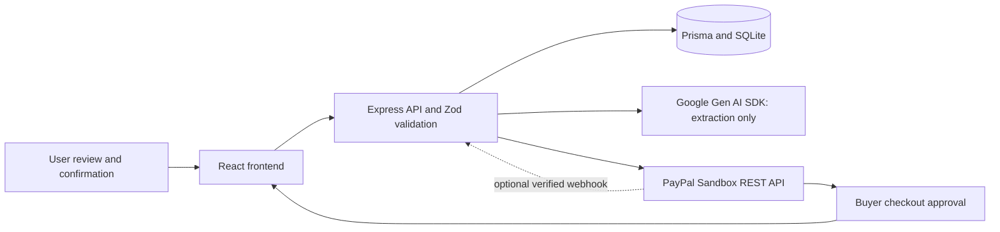

# PayPilot AI

PayPilot AI helps freelancers turn a written request into a reviewed invoice and collect a PayPal Sandbox payment. It uses React, TypeScript, Vite, Tailwind CSS and Lucide for the interface; Express, Prisma and SQLite for the API and storage; the official Google Gen AI SDK for extraction; and PayPal REST Invoicing v2 and Orders v2.

**Status:** The public Render build offers a guest workspace through an anonymous server session. Each browser's invoices are isolated by an HttpOnly cookie and stored in SQLite. Render Free deletes that local database on restarts, and clearing the cookie loses access to the browser's records. The entry screen shows freelancer sign-in and registration, which remain disabled until persistent Turso storage and a verified Resend sender are configured. Gemini and PayPal Sandbox still require valid server credentials and real provider testing.

## Implemented scope and architecture

| Stage | Implementation |
| --- | --- |
| 1 | Landing, dashboard, AI invoice editor, invoice list/details, payment return/cancellation pages; reusable responsive UI. |
| 2 | Persistent invoices, draft editing with version checks, status management, payments, dashboard totals separated by currency, server validation. |
| 3 | Structured Gemini extraction, clarification, editable review, explicit confirmation, bounded calls and safe errors. |
| 4 | Sandbox OAuth, order creation, approval redirect, capture, verification, reconciliation, retries and signature-verified completed-capture webhooks. |
| 5 | Focused security review and 40 automated tests. Fixed stale checkout state after lease acquisition and malformed provider responses being classified as client errors. |
| 6 | Production build, private Render Blueprint, environment/setup/deployment guide, submission checklist, screenshot placeholders and demo script. |



The server serves the built frontend and `/api` from one process. Development uses Vite's API proxy. Hash routes need no server fallback. User → Invoice → Payment relationships retain line items and notes; Checkout stores unique order associations, persisted request keys and a database lease. Money uses integer minor units; USD, EUR, GBP and INR currently use two decimals. Account support for a currency still needs provider testing.

```text
client/src/              Existing pages, components, invoice adapter and API client
server/src/              API, configuration, startup, migrations and tests
server/src/services/     Modular Gemini and PayPal services
shared/                 Safe shared schemas and types; no credentials
prisma/                 Schema and additive migration history
render.yaml             Free Render web service with temporary SQLite data
.env.example            Placeholder environment configuration
AGENTS.md               Project rules and stage boundaries
```

The public guest workspace uses the existing server invoice, Gemini and PayPal Sandbox routes. Each browser's guest cookie selects a different database user; PayPal invoice sending remains an explicit action after invoice creation. When configured, PayPal handles its customer notification. In optional signed-in `/app/` accounts, confirming a new invoice immediately calls Resend from the backend. Provider acceptance is not proof of inbox delivery. Live-money payments and refunds/reversal reconciliation are outside this Sandbox implementation.

## Run locally

Use Node.js 24.14.0 (the Render pin); the package requires Node 22.12 or newer. Run from the repository root:

```powershell
npm ci
if (-not (Test-Path .env)) { Copy-Item .env.example .env }
npm run db:generate
npm run db:migrate
npm run dev
```

On macOS/Linux, create `.env` with `test -f .env || cp .env.example .env` instead. Open `http://127.0.0.1:5173`; the API binds to `127.0.0.1:3001`. Existing migrations apply without resetting records. Never seed the active workspace with test fixtures.

For the built app, set `CLIENT_ORIGIN=http://127.0.0.1:3001` in `.env`, then run:

```text
npm run build
npm start
```

Open `http://127.0.0.1:3001`. Restore origin port 5173 before returning to Vite development. `npm run preview` previews frontend assets only; use `npm start` for the complete built application.

| Command | Purpose |
| --- | --- |
| `npm run dev` | Frontend and backend together |
| `npm run db:generate` | Generate Prisma client |
| `npm run db:migrate` | Create SQLite file if absent and apply committed migrations without reset |
| `npm test` | Unit, HTTP and temporary SQLite tests; provider responses mocked |
| `npm run lint` / `npm run typecheck` | Source lint / frontend and backend type checks |
| `npm run build` | Production backend and frontend output in ignored `dist/` |
| `npm run check` | Lint, types, all tests and both builds |
| `npm start` | Serve built app and API |

## Environment variables

Server secrets belong in the ignored root `.env` locally or Render's private environment. Never add secrets to `VITE_*`, GitHub, screenshots, logs or the video. `.env.example` contains placeholders. `VITE_PUBLIC_DEMO` is a public build-time flag for the anonymous frontend.

| Variable | Required / default | Local / Render configuration |
| --- | --- | --- |
| `DATABASE_URL` | Required | Local and free Render `file:./dev.db` (relative to `prisma/`); free Render storage is temporary. |
| `ACCOUNTS_ENABLED` | Default `false` | Optional signed-in account mode at `/app/`; requires Turso and a configured email provider. Can run alongside public guest access. |
| `PUBLIC_GUEST_ACCESS` | Default `false` | Set `true` for anonymous server-backed public invoices. A browser cookie isolates each guest. |
| `VITE_ACCOUNTS_ENABLED` | Default `false` | Shows the optional freelancer sign-in link to `/app/` in the guest build when account mode is configured. |
| `TURSO_DATABASE_URL` / `TURSO_AUTH_TOKEN` | Account mode only | Hosted libSQL URL and private token from Turso. Never add the token to `VITE_*`. |
| `PORT` | Default `3001` | Render service pins `3001`. |
| `HOST` | Default `127.0.0.1` | Local loopback; free Render uses `0.0.0.0` for port detection. |
| `CLIENT_ORIGIN` | Default `http://127.0.0.1:5173` | Built local app: `http://127.0.0.1:3001`; free Render: `https://paypilot-ai-3sho.onrender.com`. |
| `VITE_PUBLIC_DEMO` | Default false | Keep false for the server-backed public workspace. True selects the old browser-only preview. |
| `VITE_GUEST_MODE` | Default false | Public build-time label for the guest workspace; contains no secret. |
| `LOCAL_USER_EMAIL` | Default `owner@example.test` | Stable local owner identity, **not authentication**. Changing it selects/creates another owner; it does not transfer invoices. |
| `GEMINI_API_KEY` | Required for AI only | Server secret from your Google AI project; blank disables AI. |
| `GEMINI_MODEL` | Required for AI only | A model ID available to your project supporting structured JSON; the example value is illustrative, not verified account access. |
| `EMAIL_PROVIDER` | Default `resend` | Set `brevo` to use Brevo Free for account verification and automatic account invoice email. |
| `RESEND_API_KEY` / `BREVO_API_KEY` | Selected provider key required for account mode | Server secret. Set only the key matching `EMAIL_PROVIDER`; never use `VITE_*`. |
| `EMAIL_FROM` | Required for account mode and automatic email | Sender address verified with the selected provider. Brevo can verify an individual address without a custom domain. |
| `INVOICE_TIMEZONE` | Default `Asia/Kolkata` | Valid IANA timezone used to resolve relative due dates. |
| `PAYPAL_ENV` | Only `sandbox`; default | Production mode is rejected. |
| `PAYPAL_CLIENT_ID` | Required for PayPal only | Sandbox REST application's client ID. |
| `PAYPAL_CLIENT_SECRET` | Required for PayPal only | Same app's server secret; never sent to the browser. |
| `PAYPAL_BUSINESS_NAME` | Required for PayPal Invoicing | Business name displayed on invoices; use the Sandbox business account's name. |
| `PAYPAL_MERCHANT_ID` | Required for PayPal only | Same Sandbox business account's merchant ID, not its REST client ID. |
| `PAYPAL_WEBHOOK_ID` | Required for webhook updates | Sandbox webhook subscription ID for signature verification. Manual **Check PayPal status** works without it. |
| `NODE_VERSION` | Render runtime setting | Blueprint pins `24.14.0`; not an application setting. |
| `NODE_ENV` | Render `production` | Platform/runtime setting; development scripts work without it. |

Missing AI credentials preserve manual invoice entry. Missing PayPal credentials disable checkout and return a clear server configuration error. Invalid configuration reports variable names without their values. Server-origin validation remains restricted even when `HOST=0.0.0.0`.

### Automatic invoice email

In the public guest workspace, **Send PayPal Sandbox invoice** uses PayPal's Invoicing API when Sandbox credentials are configured; PayPal sends the recipient notification. In configured signed-in account mode, **Confirm and send invoice** saves the validated invoice and immediately calls the selected email provider from the backend. A rejected or uncertain send reports an error and leaves a draft for retry. Acceptance does **not** prove inbox delivery. Never use real client data on the Free service's temporary local SQLite.

For Brevo Free, [create an account](https://www.brevo.com/), [verify an email sender](https://help.brevo.com/hc/en-us/articles/208836149-Create-a-new-sender-From-name-and-From-email) using the code sent to an address you own, and generate an API key. Set `EMAIL_PROVIDER=brevo`, `BREVO_API_KEY`, and `EMAIL_FROM` privately on Render. A free email address can have limited deliverability or be rewritten by Brevo. The existing Resend path remains available with `EMAIL_PROVIDER=resend`, a verified domain, and `RESEND_API_KEY`. Test with a recipient you control and check provider activity and inbox separately. Do not paste keys into chat or GitHub.

### Freelancer sign-in and persistent storage (prepared, not live)

1. Create a [Turso](https://turso.tech/) account and a new hosted database. Generate a database auth token. The app uses the existing Prisma SQLite schema through the official libSQL adapter; `DATABASE_URL` remains a local SQLite URL for Prisma code generation, while `TURSO_DATABASE_URL` and `TURSO_AUTH_TOKEN` select the hosted database at runtime.
2. Create a Brevo account, verify a sender email you own, and generate an API key. Set `EMAIL_PROVIDER=brevo`, `BREVO_API_KEY`, and `EMAIL_FROM` privately. The same sender address sends account verification and confirmed invoices; account holders do not send from their personal mailbox.
3. In Render's private Environment page, set both Turso values and the Brevo values. Set `ACCOUNTS_ENABLED=true` and `VITE_ACCOUNTS_ENABLED=true`; keep `PUBLIC_GUEST_ACCESS=true` and `VITE_PUBLIC_DEMO=false` so visitors can still use the guest workspace at `/`. Save and redeploy. The account build at `/app/` requires email/password sign-in. The startup migration script applies the existing SQL migrations to the hosted database in order and records checksums. Use a **new empty database**; back up any existing database before changing schema. If migration fails, the server does not start.
4. Visit `/app/#/register`, verify the email link, then sign in at `/app/`. Review an invoice addressed to an email you control and click **Confirm and send invoice**. Check both Brevo activity and the inbox. Retry a failed send with the same confirmation; it must not create another invoice. Test that a second account cannot view the first account's invoice or a guest invoice. Provider acceptance means submitted, not delivered to the inbox.

The account route is unavailable while account mode is off. After activation both guest and account invoices and sessions reside in Turso; existing guest invoices on Render's temporary SQLite do not migrate. Registration is rate limited per process; account password recovery, provider delivery webhooks and a live Turso/Brevo test remain open work. Individual accounts cannot use the shared PayPal merchant credentials; each freelancer needs a separate merchant connection before their PayPal checkout can be enabled. Never put database or email tokens in GitHub or chat.

### Gemini configuration and behavior

Create an API key in [Google AI Studio](https://aistudio.google.com/apikey), select a structured-output model available to that project, and set `GEMINI_API_KEY` and `GEMINI_MODEL` on the server. Restart locally or manually redeploy on Render. Check project access/quota yourself; no live model test is included in the automated suite.

The modular `server/src/services/gemini-invoice.ts` uses `@google/genai`, structured JSON output and Zod validation. It extracts customer name/email, decimal amount, currency, description and due date. Missing information returns null plus clarification questions; customer names/emails not found verbatim in the request are discarded. A bare `$` is ambiguous, so use `USD`. Relative dates are computed using the server's reference date and timezone.

Generation runs only when requested, with 2,000-character prompts, bounded output, timeouts, no automatic retry, one request in flight and six attempts per minute per process. Extraction has no database write path. The user edits fields, reviews them and separately confirms creation; the API requires `confirmed: true`. Interpretation remains fallible, so review every field.

### PayPal Sandbox configuration and flow

In the [PayPal Developer Dashboard](https://developer.paypal.com/dashboard/), create/select a **Sandbox** REST app under a Sandbox business account with Invoicing enabled. Set its client ID, secret, business name and business merchant ID on the server. Use a separate Sandbox personal buyer account to approve payment. Restart/redeploy after configuration. Do not submit passwords or keys in chat.

**Send invoice (owner workspace):** The backend reserves the local invoice, then calls `POST /v2/invoicing/invoices`, stores PayPal's `INV2-...` ID, calls `POST /v2/invoicing/invoices/{id}/send` with recipient notification enabled, and verifies the provider state with `GET /v2/invoicing/invoices/{id}`. The saved recipient, line items, due date, amount and currency supply the request. A repeat send rechecks the same PayPal invoice and does not create a second one. If draft creation timed out before an ID was saved, the backend searches by its stable invoice number; an ambiguous result requires manual reconciliation. PayPal's accepted send sets local status `ISSUED`, never `PAID`. A PayPal-hosted Sandbox invoice link is shown only when PayPal returns an allowlisted Sandbox URL. The recipient notification is PayPal's, not a PayPilot-made Sandbox account notification.

**Payment verification:** PayPilot fetches the stored PayPal invoice on an explicit status check or verified webhook. It records the PayPal invoice ID, payment transaction ID, amount, currency and PayPal timestamp, and marks `PAID` only for a matching `PAID` invoice with a zero balance and verified PayPal payment transactions. `PAYMENT_PENDING` and partial payments remain outstanding. A unique payment reference and database transaction prevent repeat records. Existing Orders v2 checkout remains available only for invoices that have not entered the Invoicing flow.

**Overdue status:** The backend changes past-due `ISSUED` invoices to `OVERDUE` on invoice list/detail/dashboard requests and on an hourly process timer. Drafts and paid invoices are excluded; a verified payment changes `OVERDUE` to `PAID`. The hourly timer does not run while a Render Free instance sleeps, so the next page request refreshes status. Automatic overdue/reminder emails are not part of this PayPal invoice-send workflow.

1. Create and confirm a valid invoice, then click **Pay / Retry in Sandbox** and confirm checkout.
2. The backend checks ownership, loads the saved amount/currency, issues and locks the draft, stores idempotency keys and creates an Orders v2 order using server-side OAuth. The fixed API base is `https://api-m.sandbox.paypal.com`.
3. Follow the returned allowlisted Sandbox approval link and approve as the buyer. The API base itself is not a checkout webpage.
4. On return, **Check payment** reads server state. Click **Verify and capture approved payment** to request capture. A return URL alone never marks PAID.
5. The backend verifies the stored order association, invoice, merchant, amount and currency, then retrieves and validates the completed final capture. A database transaction records one unique capture and marks the invoice PAID.
6. Refresh/replay checks and confirm one completed payment remains. On an uncertain response, check the existing order; do not pay separately. Retries GET first, reuse persisted keys, and replace only verified VOIDED orders with no captures. Expired uncertain attempts require manual reconciliation.

The database lease serializes payment operations, and unique order/capture/invoice-payment constraints prevent duplicate records in the tested scenarios. Invoice editing and manual status updates are blocked once a checkout exists. Pending, denied or mismatched captures do not settle an invoice.

Optional webhook: subscribe to `INVOICING.INVOICE.PAID`, `INVOICING.INVOICE.CANCELLED`, `INVOICING.INVOICE.SENT`, and `PAYMENT.CAPTURE.COMPLETED` on the same Sandbox REST app. Set `PAYPAL_WEBHOOK_ID` and register `https://paypilot-ai-3sho.onrender.com/api/paypal/webhook` in the PayPal Developer Dashboard after deployment. This public route verifies PayPal's original webhook signature with PayPal before any processing, then fetches the associated invoice or order again. PayPal's Sandbox business account shows its own invoice and transaction activity; PayPilot only displays verified local state. Actual webhook delivery needs a live Sandbox test. The Free service's local SQLite is temporary, so use synthetic tests there until durable storage is configured.

PayPal reports `INVOICING.INVOICE.PAID` for partial or pending payments too, so the event alone never marks the local invoice paid. PayPal controls its buyer emails and Sandbox account activity; PayPilot cannot guarantee inbox receipt or create a PayPal account notification. The separate Resend path reports provider acceptance only and has no delivery webhook yet.

API endpoints: `GET /api/health`, `GET /api/ai/status`, `POST /api/ai/invoice-draft`, invoice CRUD/status and dashboard routes; `GET /api/paypal/status`, `POST /api/invoices/:id/paypal/order` with only `{ "confirmed": true }`, `POST /api/invoices/:id/paypal/check` with `{ "orderId": "...", "capture": false }` (explicit true permits capture), and `POST /api/paypal/webhook`.

References: [Invoicing v2](https://developer.paypal.com/api/invoicing/v2/), [Orders v2](https://developer.paypal.com/docs/api/orders/v2/), [webhook verification](https://developer.paypal.com/api/rest/webhooks/rest/).

## GitHub repository preparation

The existing remote is [jsbinaryrepo/Paypilot-AI](https://github.com/jsbinaryrepo/Paypilot-AI). Do not initialize another repository or overwrite its history. At inspection, implementation files were largely untracked; a successful local build does not mean they are on GitHub.

Before publishing, review and stage the implementation explicitly:

```text
git status --short
git remote -v
git check-ignore .env prisma/dev.db
git add .gitignore .env.example AGENTS.md README.md render.yaml package.json package-lock.json eslint.config.js tsconfig.server.json vite.config.ts client server shared prisma
git diff --cached --stat
git diff --cached
```

Review the staged diff for credentials, personal data, unrelated work and generated artifacts before committing. Keep `.env`, SQLite databases, `node_modules/` and `dist/` ignored. Use a reviewed submission commit SHA so reviewers can reproduce the build. Add a demo video link only after it exists; do not invent a license.

## Free Render deployment

The existing Render **Free Web Service** is `Paypilot-AI` at [paypilot-ai-3sho.onrender.com](https://paypilot-ai-3sho.onrender.com). `render.yaml` records the free configuration. The public frontend calls the Express API directly. A random, HttpOnly, Secure guest cookie selects each visitor's database user without a sign-in page. Other guest cookies cannot read that visitor's invoices. Render Free's local SQLite is temporary, so records can disappear on restart; losing the cookie also loses access. Use synthetic demo data only.

Configure the existing service in Render from the repository root and `main` branch:

| Setting | Value |
| --- | --- |
| Build command | `npm ci --include=dev && npm run db:generate && npm run build` |
| Start command | `node dist/server/src/migrate.js && npm start` |
| `NODE_VERSION` / `NODE_ENV` | `24.14.0` / `production` |
| `DATABASE_URL` | `file:./dev.db` |
| `HOST` / `PORT` | `0.0.0.0` / `3001` |
| `CLIENT_ORIGIN` | `https://paypilot-ai-3sho.onrender.com` |
| `PUBLIC_GUEST_ACCESS` | `true` |
| `VITE_PUBLIC_DEMO` / `VITE_GUEST_MODE` | `false` / `true` |
| `EMAIL_PROVIDER` / `BREVO_API_KEY` / `EMAIL_FROM` | Optional; set Brevo and the key only after verifying a sender email |
| `LOCAL_USER_EMAIL` / `INVOICE_TIMEZONE` | `owner@example.test` / `Asia/Kolkata` |
| `PAYPAL_ENV` | `sandbox` |

The server no longer reads `DEMO_PASSWORD` or sends `WWW-Authenticate`. Remove that obsolete Render variable. Keep Gemini, PayPal and email provider credentials private on the server; missing credentials disable their provider actions with an explicit error. A public guest session is not verified identity, and anyone can consume configured API quota or send a Sandbox invoice from the configured merchant. Use Sandbox and test data only; configure provider quotas and abuse controls before treating this as a production service.

After pushing a reviewed commit, set `PUBLIC_GUEST_ACCESS=true`, `VITE_PUBLIC_DEMO=false` and `VITE_GUEST_MODE=true` in Render, then rebuild/deploy. Verify `/api/health` and the invoice UI respond without a Basic challenge, then create a synthetic invoice in one browser and confirm it is absent in a fresh browser. Real Gemini, email and PayPal Sandbox tests require their respective credentials and provider accounts.

## Verification and manual demo

The automated suite checks anonymous guest isolation and absence of a Basic challenge, plus the existing invoice, Gemini, email and PayPal behavior using local databases and mocked providers. Report the current test and deployment results after running them; no live provider result should be inferred from mocked tests.

The earlier private Blueprint check and startup smoke result apply only to the prior paid configuration. The Free service requires separate deployment verification. Automated provider tests do not make real external calls.

Render already has a masked `GEMINI_API_KEY` entry. Its value and live access were not inspected; `GEMINI_MODEL` and PayPal settings were not visible among the service variables. AI needs both key and model, and PayPal needs its own Sandbox settings. Do not copy or expose local secrets to complete the demo automatically.

No real provider transaction, live Gemini interpretation, or webhook delivery is claimed as tested. Remaining limitations include ephemeral SQLite, guest sessions with no account recovery, public API quota exposure, manual reconciliation of expired uncertain attempts, and no refund/reversal processing. Tests do not establish production security guarantees.

Before recording, configure your own credentials, use synthetic customer data, and rehearse this sequence:

1. Open landing/dashboard, then enter: `Create an invoice for Rahul (rahul@example.test) for USD 150 for landing page design, due in 5 days.` Generate once. Confirm that no invoice exists yet; show fields/clarifications and edit a value.
2. Review, explicitly confirm, reload, and show the persisted invoice/list/dashboard. With missing credentials, use manual entry and clearly label AI as untested; do not simulate generation.
3. Start Sandbox checkout, approve with the separate buyer, return and explicitly capture. Show success only after actual server verification. Inspect one completed payment matching the saved amount/currency and a PAID invoice.
4. Replay Check payment, then separately rehearse cancellation/resume and a funding failure using supported Sandbox tools. For uncertain responses, reconcile the existing order rather than starting a separate payment. If webhook relay is configured, test valid delivery/replay and rejected signatures.
5. Record actual outcomes and any failures. Keep provider accounts, tokens, keys, real emails and terminal secret values out of the recording. If a live flow fails, disclose it and show the implemented code/tests rather than a fabricated success screen.

## Screenshot placeholders

No images are fabricated or attached. Replace these entries only with screenshots captured from the actual app; create an image folder only when real assets exist.

| Planned image | Capture / current status |
| --- | --- |
| Landing and responsive navigation | Placeholder — not captured |
| Dashboard with persisted synthetic invoices | Placeholder — not captured |
| AI extracted fields and clarification/review | Placeholder — live Gemini not verified |
| Invoice list and saved details | Placeholder — not captured |
| Sandbox approval and server-verified payment | Placeholder — real transaction not verified |
| Cancellation/resume and safe error state | Placeholder — not captured |

## Demo video script — target 2 minutes 45 seconds

Rehearse within these time slots; edit waiting time transparently if needed. Record a successful provider flow only after it actually succeeds. This is a script, not evidence of a completed demo.

| Time | Screen and narration |
| --- | --- |
| 0:00–0:20 | Landing → dashboard. “PayPilot AI helps freelancers turn a written request into a reviewed invoice and a PayPal Sandbox checkout. This is a single-user prototype.” |
| 0:20–0:55 | Enter the Rahul request and generate once. “Gemini extracts structured fields. Missing details require clarification. I can edit every value, and generation alone creates no invoice.” If credentials are unavailable, say so and show manual entry instead. |
| 0:55–1:20 | Change a field, review and explicitly confirm; reload the saved invoice. “Server validation checks the total, currency and line items. Prisma stores the confirmed draft in SQLite.” |
| 1:20–2:05 | Start checkout, approve as the Sandbox buyer, return and capture. “The server uses the stored invoice total. A return URL does not prove payment; the server verifies the associated order and completed capture.” Only show a verified result if achieved; otherwise state the actual error and that real Sandbox testing remains incomplete. |
| 2:05–2:25 | Refresh Check payment and show recorded state if verified. “Retries reconcile the existing order and use persisted request keys. Automated tests cover duplicate requests, mismatched totals and uncertain responses using mocked APIs.” |
| 2:25–2:45 | Show architecture/tests and close. “React calls Express; Gemini extracts and PayPal handles Sandbox checkout. We have automated validation and payment tests. The free Render demo has temporary data; its actual deployment and live provider test status are disclosed in the submission.” |

## Final submission checklist

- [ ] Review and push the intended files; supply repository URL and submission commit SHA.
- [ ] Re-run `npm run check` on that commit and record the actual result.
- [ ] Configure provider credentials privately and verify live Gemini/model access.
- [ ] Complete the manual Sandbox approval/capture, cancellation/retry and duplicate checks; record actual results.
- [ ] Verify the existing free Render service starts, challenges for the demo password and serves authenticated health/frontend.
- [ ] Disclose ephemeral SQLite and never claim payment record persistence on the free service.
- [ ] Capture and redact actual screenshots; replace placeholders only with real evidence.
- [ ] Record/upload the video under 3 minutes and add its real link to the submission.
- [ ] Disclose mocked versus real tests, missing live verification, public-access limitations and refunds/reversals scope.
- [ ] Confirm the hackathon's required fields/rules and provide team attribution and any license information you actually have.
